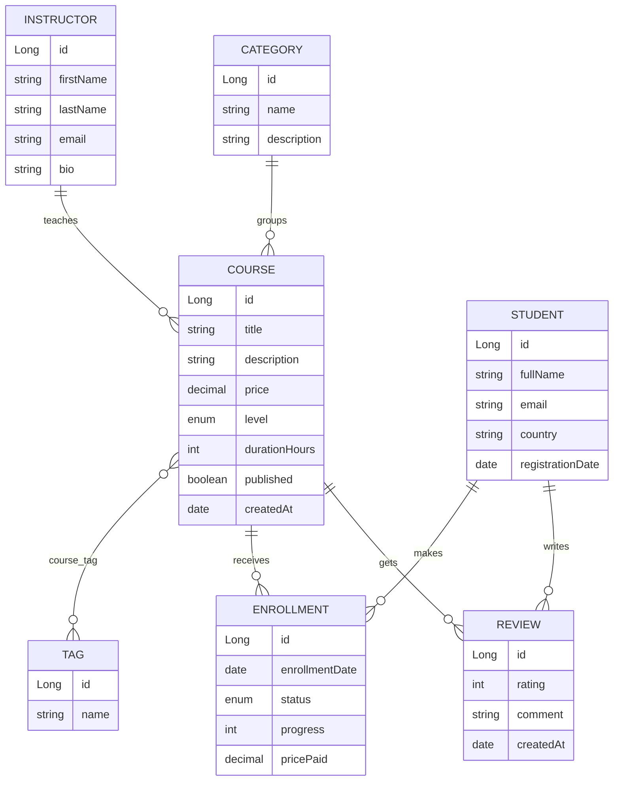

# E-Learning Platform – Spring Boot REST API (DS1)

Mini project for the **DS1 – Web Development: Spring Boot** assessment.
A REST API that manages an online learning platform: instructors publish courses, students enroll, follow their progress and review the courses.

---

## 1. Business context

An online platform sells video courses.

* **Instructors** create **courses** that belong to a **category** and carry several **tags**.
* A course starts as a **draft** and must be **published** before students can enroll.
* **Students** enroll in published courses (only once per course). The price paid is stored at the moment of enrollment.
* Progress is tracked from 0 to 100 %. Reaching 100 % completes the enrollment.
* Students who followed a course can leave **one review** (1 to 5 stars).
* The platform can query popular courses, best rated courses, revenue per instructor, students who never enrolled, etc.

## 2. Technologies

| Tool | Usage |
|---|---|
| Java 17 | Language |
| Spring Boot 3.3 | Application framework (Web, Data JPA, Validation) |
| Spring Data JPA / Hibernate | ORM and repositories |
| MySQL 8 | Database (the schema is auto-created) |
| Lombok | Removes getter/setter boilerplate |
| H2 (test scope) | In-memory database for automated tests |
| JUnit 5, Mockito, MockMvc | Unit and integration tests |
| Postman | API tests (collection in `/postman`) |

## 3. Data model (8 tables, 7 entities)



### Entities and relationships

| Entity | Main attributes | Relationships |
|---|---|---|
| `Instructor` | firstName, lastName, email (unique), bio | **OneToMany** → Course |
| `Category` | name (unique), description | **OneToMany** → Course |
| `Tag` | name (unique) | **ManyToMany** ↔ Course (inverse side) |
| `Course` | title, description, price, level (`BEGINNER/INTERMEDIATE/ADVANCED`), durationHours, published, createdAt | **ManyToOne** → Instructor, **ManyToOne** → Category, **ManyToMany** ↔ Tag (owner, join table `course_tag`), **OneToMany** → Enrollment, Review |
| `Student` | fullName, email (unique), country, registrationDate | **OneToMany** → Enrollment, Review |
| `Enrollment` | enrollmentDate, status (`ACTIVE/COMPLETED/CANCELLED`), progress (0-100), pricePaid | **ManyToOne** → Student, **ManyToOne** → Course. Unique (student, course). *Association entity: resolves the Student ↔ Course many-to-many and carries its own data* |
| `Review` | rating (1-5), comment, createdAt | **ManyToOne** → Student, **ManyToOne** → Course. Unique (student, course) |

### Data validation (Bean Validation)

`@NotBlank`, `@Email`, `@Size`, `@NotNull`, `@DecimalMin`, `@Digits`, `@Min`, `@Max` are used on the entities and on the request DTOs (`CourseRequest`, `EnrollmentRequest`, `ReviewRequest`...). Controllers use `@Valid`.

## 4. Architecture

```
src/
 ├─ main/java/com/esb/elearning/
 │   ├─ model/        JPA entities + enums (Instructor, Category, Tag, Course, Student, Enrollment, Review)
 │   ├─ repository/   Spring Data JPA interfaces + custom queries
 │   ├─ service/      Business logic, transactions, business rules
 │   ├─ controller/   REST controllers (HTTP + status codes only, no logic)
 │   ├─ dto/          Request payloads (records) and query projections
 │   ├─ exception/    Custom exceptions + GlobalExceptionHandler (@RestControllerAdvice)
 │   ├─ config/       DataSeeder (demo data)
 │   └─ ElearningApplication.java
 ├─ main/resources/application.properties
 └─ test/             Unit tests (Mockito) + integration tests (MockMvc + H2)
postman/              Exported Postman collection
```

Layered architecture: **Controller → Service → Repository → Database**. Controllers never call repositories directly.

## 5. Running the project

### Prerequisites
* JDK 17+
* Maven 3.8+ (or use your IDE: Spring Tools, IntelliJ, VS Code)
* MySQL 8 running on `localhost:3306`

### Steps
1. Clone the repository.
2. Open `src/main/resources/application.properties` and set your MySQL **username / password**.
   The database `elearning_db` is created automatically (`createDatabaseIfNotExist=true`).
3. Start the application:
   ```bash
   mvn spring-boot:run
   ```
4. The API is available at **http://localhost:8080**.
5. Demo data (3 instructors, 5 courses, 4 students, enrollments, reviews) is inserted at the first start.
   Disable it with `app.seed.enabled=false`.

### Run the tests (no MySQL required – they use H2)
```bash
mvn test
```

## 6. REST API

Base URL: `http://localhost:8080/api`

### Instructors – `/api/instructors`
| Method | URL | Description | Success |
|---|---|---|---|
| POST | `/api/instructors` | Create | 201 |
| GET | `/api/instructors` | List all | 200 |
| GET | `/api/instructors/{id}` | Get one | 200 |
| PUT | `/api/instructors/{id}` | Update | 200 |
| DELETE | `/api/instructors/{id}` | Delete (refused if he owns courses) | 204 |

### Categories – `/api/categories` and Tags – `/api/tags`
Same 5 CRUD operations as instructors (`POST`, `GET`, `GET /{id}`, `PUT /{id}`, `DELETE /{id}`).
A category / tag cannot be deleted while courses use it.

### Students – `/api/students`
| Method | URL | Description | Success |
|---|---|---|---|
| POST / GET / GET `/{id}` / PUT `/{id}` / DELETE `/{id}` | `/api/students` | CRUD | 201 / 200 / 200 / 200 / 204 |
| GET | `/api/students/without-enrollment` | **Custom query** – students who never enrolled | 200 |
| GET | `/api/students/course/{courseId}` | **Custom query** – students following a course | 200 |

### Courses – `/api/courses`
| Method | URL | Description | Success |
|---|---|---|---|
| POST | `/api/courses` | Create a draft course (instructorId, categoryId, tagIds) | 201 |
| GET | `/api/courses` | List all | 200 |
| GET | `/api/courses/{id}` | Get one | 200 |
| PUT | `/api/courses/{id}` | Update | 200 |
| PATCH | `/api/courses/{id}/publish` | Publish a draft | 200 |
| DELETE | `/api/courses/{id}` | Delete (refused if it has enrollments/reviews) | 204 |
| GET | `/api/courses/instructor/{instructorId}` | Courses of an instructor | 200 |
| GET | `/api/courses/category/{categoryId}` | Courses of a category | 200 |
| GET | `/api/courses/by-tag/{tagName}` | **Custom query** – courses having a tag | 200 |
| GET | `/api/courses/search?keyword=&level=&maxPrice=` | **Custom query** – catalogue search (published only) | 200 |
| GET | `/api/courses/popular?limit=5` | **Custom query** – most popular courses | 200 |

### Enrollments – `/api/enrollments`
| Method | URL | Description | Success |
|---|---|---|---|
| POST | `/api/enrollments` | Enroll `{studentId, courseId}` | 201 |
| GET | `/api/enrollments` | List all | 200 |
| GET | `/api/enrollments/{id}` | Get one | 200 |
| GET | `/api/enrollments/student/{studentId}` | Enrollments of a student | 200 |
| GET | `/api/enrollments/course/{courseId}` | Enrollments of a course | 200 |
| PATCH | `/api/enrollments/{id}/progress` | Body `{ "progress": 0-100 }` (100 ⇒ COMPLETED) | 200 |
| PATCH | `/api/enrollments/{id}/cancel` | Cancel an enrollment | 200 |
| DELETE | `/api/enrollments/{id}` | Delete | 204 |
| GET | `/api/enrollments/revenue-by-instructor` | **Custom query** – revenue per instructor | 200 |

### Reviews – `/api/reviews`
| Method | URL | Description | Success |
|---|---|---|---|
| POST | `/api/reviews` | Create `{studentId, courseId, rating, comment}` | 201 |
| GET | `/api/reviews` | List all | 200 |
| GET | `/api/reviews/{id}` | Get one | 200 |
| GET | `/api/reviews/course/{courseId}` | Reviews of a course | 200 |
| PUT | `/api/reviews/{id}` | Update `{rating, comment}` | 200 |
| DELETE | `/api/reviews/{id}` | Delete | 204 |
| GET | `/api/reviews/top-rated?minRating=4` | **Custom query** – best rated courses | 200 |

### Example requests

Create a course:
```http
POST /api/courses
{
  "title": "Spring Boot from Zero to Hero",
  "description": "Build REST APIs with Spring Boot and JPA",
  "price": 49.90,
  "level": "INTERMEDIATE",
  "durationHours": 25,
  "instructorId": 1,
  "categoryId": 1,
  "tagIds": [1, 2]
}
```

Enroll a student:
```http
POST /api/enrollments
{ "studentId": 1, "courseId": 1 }
```

## 7. Custom queries (repository layer)

| # | Repository method | Business need | Technique |
|---|---|---|---|
| 1 | `StudentRepository.findStudentsWithoutEnrollment()` | Marketing: contact registered students who never bought a course | JPQL `IS EMPTY` |
| 2 | `StudentRepository.findStudentsByCourse(courseId)` | Instructor: list the learners of a course | JPQL on the association entity |
| 3 | `CourseRepository.findByTagsNameIgnoreCase(tag)` | Browse the catalogue by tag | Derived query through the ManyToMany |
| 4 | `CourseRepository.search(keyword, level, maxPrice)` | Catalogue search with optional filters | JPQL with `LIKE` + optional parameter |
| 5 | `CourseRepository.findMostPopular(Pageable)` | Home page "trending courses" | JPQL `LEFT JOIN … GROUP BY … COUNT` + interface projection + `Pageable` |
| 6 | `EnrollmentRepository.findRevenueByInstructor()` | Finance: income per instructor (cancelled enrollments excluded) | JPQL `JOIN … SUM / COUNT` + projection |
| 7 | `ReviewRepository.findTopRatedCourses(minRating)` | Quality: best rated courses | JPQL `AVG … HAVING` + projection |

## 8. Business rules (service layer)

* A course is created as a **draft**; it can be published only if it has a description.
* A student can enroll **only in a published course**, and **only once** (HTTP 422 / 409 otherwise).
* `pricePaid` = the course price at enrollment time.
* Progress `100` ⇒ status `COMPLETED`; a cancelled enrollment cannot progress; a completed one cannot be cancelled.
* Only a student with a **non-cancelled enrollment** can review a course, **once per course**.
* Emails (instructor, student), category names and tag names are **unique**.
* Referential protection: cannot delete an instructor / category / tag that is still used, a course with enrollments or reviews, or a student with enrollments or reviews.

## 9. Error handling

All errors go through `GlobalExceptionHandler` and share the same JSON structure:

```json
{
  "timestamp": "2026-11-02T10:15:30.123",
  "status": 400,
  "error": "Bad Request",
  "message": "Validation failed",
  "path": "/api/instructors",
  "validationErrors": { "email": "Email format is invalid" }
}
```

| HTTP status | When |
|---|---|
| 400 Bad Request | Validation error, malformed JSON, invalid enum value, wrong parameter type |
| 404 Not Found | Entity not found, unknown URL |
| 405 / 415 | Method not allowed / unsupported content type |
| 409 Conflict | Duplicate value (email, name, enrollment, review) or database constraint |
| 422 Unprocessable Entity | Business rule violated (unpublished course, delete a used entity, …) |
| 500 | Unexpected error (no internal details are exposed) |

## 10. Postman tests

1. Start the application.
2. Import `postman/ELearning_Platform.postman_collection.json` in Postman (variable `baseUrl` = `http://localhost:8080`).
3. Click **Run collection** (Collection Runner) and keep the order. The collection:
   * **1 – CRUD operations**: creates data for each entity and stores the generated ids in collection variables.
   * **2 – Custom queries**: the 7 custom queries.
   * **3 – Error handling**: 400, 404, 409 and 422 scenarios.
   * **4 – Cleanup**: DELETE requests, then checks that the deleted resource returns 404.
4. Every request has a test script that checks the HTTP status code (and some check the body). Take a screenshot of the Runner results (all tests green) for the deliverable.

## 11. Git / GitHub deliverables checklist

```bash
git init
git add .
git commit -m "DS1 - E-Learning Platform Spring Boot project"
git branch -M main
git remote add origin https://github.com/<your-user>/elearning-platform.git
git push -u origin main
```
* Add the teacher as a collaborator: **Settings → Collaborators → Add people → `awadi.hatem@gmail.com`**.
* Add the Postman screenshots in a `docs/screenshots/` folder.

## 12. Authors

Group: _write your names here_

## 11. Web interface

A responsive browser interface is included at `src/main/resources/static/index.html`.
After starting the Spring Boot application, open **http://localhost:8080/**.

The page reads live data from the existing REST API:
- `GET /api/courses`, `/api/categories`, `/api/instructors`, `/api/students`, `/api/enrollments`
- Search, level filtering, category filtering and price sorting are performed on the loaded course catalogue.
- Enrollment submits `POST /api/enrollments` using the selected existing student and course IDs.

No separate frontend server or CORS configuration is required because Spring Boot serves the static page and API from the same origin.
